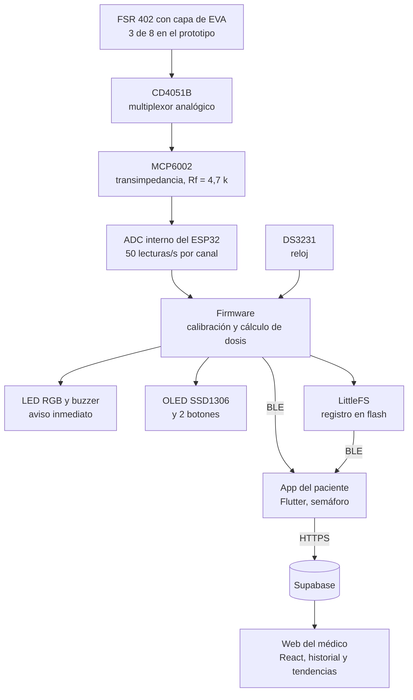

# La Bota Botona

Le botonea al médico cuánto se cuidó el paciente.

Trabajo práctico integrador de Instrumentación Biomédica II. ITBA, segundo cuatrimestre de 2026.

## Qué hace

Es un dosímetro de carga plantar integrado en una ortesis de miembro inferior. Mide en forma continua
la carga que soporta el pie durante la rehabilitación, avisa al paciente en el momento con un LED y un
buzzer cuando supera el límite prescripto, y arma un reporte objetivo de adherencia para el profesional.

Después de una cirugía de miembro inferior el médico indica un límite de apoyo, pero hoy no tiene forma
de saber si se respetó: depende de lo que el paciente recuerde y cuente. Apoyar de más retrasa la
consolidación; apoyar de menos atrasa la recuperación funcional. Este equipo convierte esa pregunta en
un número medido.

El indicador principal es la **dosis de sobrecarga**, `D = ∫ máx(0, C(t) − L) dt`, donde `C(t)` es la
carga instantánea y `L` el límite prescripto. Se reporta junto con la carga pico, el tiempo apoyado, el
tiempo en exceso, la cantidad de excedencias y el índice de cumplimiento.

## Cómo funciona



El equipo funciona solo: calcula y guarda sin depender del teléfono. La app baja lo acumulado cuando el
paciente la abre y lo sube al servidor. El médico lo lee desde la web.

## Hardware

Componentes del prototipo en protoboard.

| Componente | Función |
|---|---|
| FSR 402 con capa de EVA | Miden la fuerza en la planta. El EVA reparte la presión y mejora la repetibilidad |
| CD4051B | Multiplexor analógico: lleva los canales de a uno al amplificador |
| MCP6002 (Rf = 4,7 k) | Amplificador de transimpedancia: convierte la conductancia del FSR en tensión |
| ESP32 clásico | Lee el ADC interno a 50 muestras/s por canal, calcula la dosis y expone BLE |
| DS3231 | Reloj de tiempo real: fecha y hora de cada registro, también sin batería del teléfono |
| Flash interna (LittleFS) | Guarda los agregados por minuto y los resúmenes diarios |
| OLED SSD1306 y 2 botones | Interfaz local del equipo |
| LED RGB y buzzer | Aviso inmediato al paciente cuando se pasa del límite |
| LiPo 1S 1000 mAh + TP4056 con protección | Alimentación. **Sin regulador**: el riel es la celda, de 3,2 a 4,2 V. La medición se corrige por software contra la tensión del riel |

## Estructura del repo

```
firmware/      ESP32 (PlatformIO). Esqueleto: la dosimetría y el protocolo son finales, la carga se simula
hardware/      KiCad. Vacía por ahora, la placa está en desarrollo
app-paciente/  App del paciente en Flutter. Semáforo, excedencias del día y batería
web-medico/    Web del médico en React y Vite. Lista de pacientes, reporte y tendencias
backend/       Supabase: migraciones SQL, permisos por médico y la función de subida
docs/          Protocolo BLE (el contrato), modelo de datos y decisiones de diseño justificadas
docs/avances/  Informes del hardware real: qué se armó, qué se decidió y la calibración
scripts/       Utilidades de desarrollo: servidor falso de subida, alta de issues, ping a Supabase
```

El firmware que hace andar el prototipo es `dosimetro_calibrado.ino`, escrito en el Arduino IDE, y
todavía no está en este repo. Lee los 3 FSR, da la alarma, calcula los indicadores, corrige la deriva
del cero, maneja el reloj, el registro en flash y la pantalla, pero no habla BLE. Lo que hay en
`firmware/` es el esqueleto que sí tiene el protocolo y la dosimetría, con la carga simulada.

El protocolo BLE está en `docs/protocolo-ble.md` y es la fuente de verdad entre el firmware y las dos
interfaces. Los paquetes de ejemplo de `docs/protocolo-vectores.json` los leen los tests de C++, de Dart
y de JavaScript, así que los tres lados se verifican contra los mismos bytes.

## Cómo correr cada parte

Hace falta PlatformIO para el firmware, Flutter para la app y Node 20 para la web. Cada parte es
independiente.

**Tests de dosimetría y protocolo, sin placa:**

```bash
cd firmware && pio test -e native
```

**Firmware en la placa:**

```bash
cd firmware && pio run -e esp32dev -t upload && pio device monitor
```

`esp32dev` es el ESP32 clásico del prototipo y el entorno por defecto. El entorno `esp32s3` quedó por
si la placa final cambia, pero no es la que está armada.

**Web del médico:**

```bash
cd web-medico && npm install && npm run dev
```

Sin variables de entorno arranca con datos simulados, que alcanza para ver la interfaz. Para conectarla
a Supabase hay que poner `VITE_SUPABASE_URL` y `VITE_SUPABASE_ANON_KEY` en `.env.local`, como explica
`backend/README.md`. Los tests son `npm test` y la compilación de producción `npm run build`.

**App del paciente:**

```bash
cd app-paciente && flutter pub get && flutter run
```

Arranca en modo simulado, sin hardware ni subida. Para usar el equipo real por BLE hace falta un celular
físico, porque el emulador de Android no tiene Bluetooth:

```bash
flutter run --dart-define=SIMULADO=false
flutter run --dart-define=SUPABASE_URL=https://xxxx.supabase.co
```

Los tests son `flutter test`. Está armada para Android.

**Base de datos:**

Las migraciones de `backend/supabase/migrations/` se corren en orden desde el editor SQL de Supabase. El
procedimiento completo, incluida la función `subir-datos`, está en `backend/README.md`.

## Estado actual

Octubre de 2026.

- [x] Prototipo en protoboard funcionando de punta a punta con 3 FSR, calibrado en gramos
- [x] Lógica de dosimetría cerrada y verificada con perfiles sintéticos
- [x] Protocolo BLE definido y verificado en los tres lados contra los mismos vectores
- [x] Web del médico contra Supabase: alta de pacientes, QR de vinculación, reporte y tendencias
- [x] App del paciente: vinculación por QR, cola local de subida y reintentos
- [ ] Unir el firmware del prototipo con el protocolo BLE de este repo
- [ ] Placa en KiCad
- [ ] Sumar los 5 sensores que faltan, hasta los 8
- [ ] Calibración global contra balanza, para pasar de gramos a porcentaje del peso corporal
- [ ] Ensayos de validación: exactitud fuera de la tabla, repetibilidad, histéresis y temperatura

## Equipo

Grupo 6.

- Idan Mizrahi
- Juan Ignacio Aldana
- Miguel Á. Obeid

## Docentes

- Gustavo Panza
- Santiago Herve Birnie Scott
- Ramón Javier Igarreta
